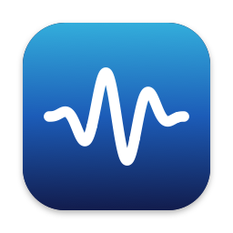

<p align="center">
  
</p>

<h1 align="center">AntiClick</h1>

<p align="center"><b>Stops USB audio interfaces and DACs from clicking every time your Mac plays a sound.</b></p>

Many USB audio devices click or pop when macOS starts playing a sound, and again when it
stops. Every alert, notification or video gives you two clicks. AntiClick is a small
menu-bar app that keeps the device's audio stream running. With nothing to start or stop,
there's nothing to click.

- **Simple:** lives in the menu bar and shows at a glance whether your device is protected.
- **Light:** native Apple silicon, about 0.02% CPU, no measurable wakeups. Your Mac still
  sleeps normally.
- **Private:** never uses the microphone.
- **Automatic:** follows you when you switch outputs, plug devices in and out, or sleep and
  wake your Mac.
- **Free and open source** (MIT).

## Download

1. Download **AntiClick-1.1.0.dmg** from the
   [latest release](https://github.com/kevinwells22/AntiClick/releases/latest).
2. Open it and drag **AntiClick** to **Applications**.
3. Open AntiClick from Applications.

AntiClick needs macOS 13 or later on a Mac with Apple silicon.

### First launch: "Apple could not verify AntiClick"

AntiClick isn't signed with a paid Apple Developer ID yet, so macOS blocks it the first time.
To allow it (you only do this once):

1. When the warning appears, click **Done**.
2. Open **System Settings > Privacy & Security** and scroll down to the message saying
   AntiClick was blocked.
3. Click **Open Anyway**, then **Open Anyway** again. Enter your password if asked.

If you're comfortable with Terminal, this does the same:
`xattr -dr com.apple.quarantine /Applications/AntiClick.app`

On first launch AntiClick asks whether to open automatically when you log in. It only
prevents clicks while it's running, so you'll usually want **Open at Login**.

## Using it

The icon next to the clock shows what AntiClick is doing:

| Icon | Meaning |
|---|---|
| Speaker with sound waves | Keeping your USB device awake, so no clicks |
| Plain speaker | Idle: the current output isn't a USB device (for example built-in speakers or AirPods) |
| Speaker with a slash | Paused |
| Speaker with "!" | Waiting: another app is using the device exclusively |

Click it for the menu:

- **Status**, and the current output device.
- **Prevent Clicks**: pause or resume.
- **Include Non-USB Devices**: also hold built-in, HDMI or Thunderbolt outputs. Off by
  default; not recommended for Bluetooth headphones.
- **Compatibility Mode**: play digital silence instead of only starting the hardware. Try it
  if your device still clicks.
- **Open at Login**, **Recent Activity**, **About** and **Quit**.

## Will it help my device?

AntiClick fixes clicks that happen **when sounds start and stop**. It was developed and
tested with a **Behringer U-Phoria UMC22** (which appears in macOS as "USB Audio CODEC",
from its TI PCM2902 chip) on macOS 27.2. It should help any USB interface or DAC that pops
when playback starts or stops.

It can't fix:

- a pop when the device is plugged in or powers up, for example when a monitor with a
  built-in USB hub wakes and reconnects it,
- clicks when an app changes the sample rate (set a fixed format in Audio MIDI Setup),
- constant noise, hum or crackling.

Tried it with your device? Please
[open an issue](https://github.com/kevinwells22/AntiClick/issues) to say whether it worked.

## How it works

macOS starts an output device when a sound begins and stops it 0.3 to 0.7 seconds after the
sound ends. Here is the UMC22 recorded while two alert sounds played:

```
20:33:48.957  RUNNING
20:33:49.804  stopped  (previous state lasted 0.85s)   <- "Tink"
20:33:57.966  RUNNING
20:34:00.336  stopped  (previous state lasted 2.37s)   <- "Glass"
```

Each start and each stop is a click. AntiClick keeps the device running, so the same test
shows one long `RUNNING`:

- **Output-only devices:** AntiClick calls `AudioDeviceStart(device, NULL)`, which starts the
  hardware without an audio callback, so AntiClick itself does no audio work at all.
- **Devices that also have inputs:** a bare hardware start would make macOS ask for
  microphone access, so AntiClick runs a silent stream with every input switched off
  instead.
- **Sleep and efficiency:** it sets `kAudioHardwarePropertySleepingIsAllowed`. Without it, a
  running audio device stops the Mac from idle-sleeping. It also asks for a large IO buffer,
  which cuts the work macOS's audio service does for the held device about 4x.

Keeping a USB device streaming costs macOS's own audio services about 2% of one CPU core
(about 0.2% of an M2 Pro's total), mostly in the USB audio driver. That's the same as
whenever any app plays audio to the device, and every keep-alive tool pays it.
[DESIGN.md](DESIGN.md) has the measurements and the alternatives that were compared
(AVAudioEngine, looping a silent file, a headless agent, and more).

## Build from source

You need the Xcode Command Line Tools (`xcode-select --install`).

```sh
git clone https://github.com/kevinwells22/AntiClick.git
cd AntiClick
make app            # build AntiClick.app (in ~/Library/Caches/AntiClick-build)
make install-app    # copy it to /Applications and open it
make dmg            # build/AntiClick-<version>.dmg for sharing
```

The app is assembled in a local folder because macOS can't code-sign app bundles on network
shares. `make app APP_ARCHS="arm64 x86_64"` builds a universal app, but its Intel half
hasn't been tested.

A signed and notarized build needs an Apple Developer Program membership and a "Developer ID
Application" certificate:

```sh
xcrun notarytool store-credentials AntiClick --apple-id you@example.com --team-id TEAMID   # once
make notarize SIGN_ID="Developer ID Application: Your Name (TEAMID)"
```

## Command-line agent (no UI)

If you'd rather have no menu-bar icon, the same engine is available as an invisible login
agent (about 4 MB of memory):

```sh
make                # build ./build/anticlick
make install        # install as a login agent and start it (options: ARGS="...")
make status         # is it running, what is it holding, what does it cost
make list           # list output devices and what would be held
make uninstall      # stop and remove it
```

| Option | Meaning |
|---|---|
| `-m, --match TEXT` | Only hold devices whose name or UID contains TEXT. Case-insensitive, repeatable, any transport. |
| `-a, --always` | Hold matching devices even when they aren't the current output. |
| `-t, --any-transport` | Also hold non-USB devices. |
| `-s, --silence` | Play digital silence on every device (the app's Compatibility Mode). |
| `-b, --buffer N` | Per-process IO buffer to request (default 4096 frames). |
| `-v, --verbose` | Log every CoreAudio event. |
| `-l, --list` | Show output devices, which ones are held, and which would be. |

Use either the app or the agent, not both. `make install-app` removes the agent for you.

## Troubleshooting

- **Still clicking?** Check that the menu says it's keeping your device awake. If it does,
  turn on **Compatibility Mode**.
- **The icon shows a plain speaker.** Your current output isn't a USB device. Turn on
  **Include Non-USB Devices** if your interface connects another way, such as Thunderbolt.
- **"Prevent sleep" from coreaudiod in `pmset -g assertions`** comes from apps that are
  actually playing audio, not from AntiClick.
- **Logs:** see **Recent Activity** in the menu, or open Console.app and search for
  `io.github.kevinwells22.anticlick`.

## Diagnostics

The scripts in `tools/` use only the Ruby that ships with macOS, so they run without any
developer tools:

```sh
ruby tools/ca-probe.rb list          # output devices, transport, running state
ruby tools/ca-probe.rb watch CODEC   # print every start/stop of a device with timestamps
ruby tools/ca-probe.rb procs         # which processes are doing audio IO right now
ruby tools/pidstat.rb --seconds 30 <pid>   # CPU, wakeups and memory of a process
```

## Project layout

```
app/          menu-bar app (Swift/AppKit), Info.plist template, icon generator
src/          engine.c / engine.h (shared engine), anticlick.c (command-line agent)
scripts/      install, uninstall and status scripts for the agent
tools/        CoreAudio diagnostics and resource measurement (built-in Ruby)
experiments/  the alternative implementations measured in DESIGN.md
```

## License

[MIT](LICENSE) © 2026 Kevin Wells. Behringer and U-Phoria are trademarks of their owners;
AntiClick isn't affiliated with them or with Apple.
